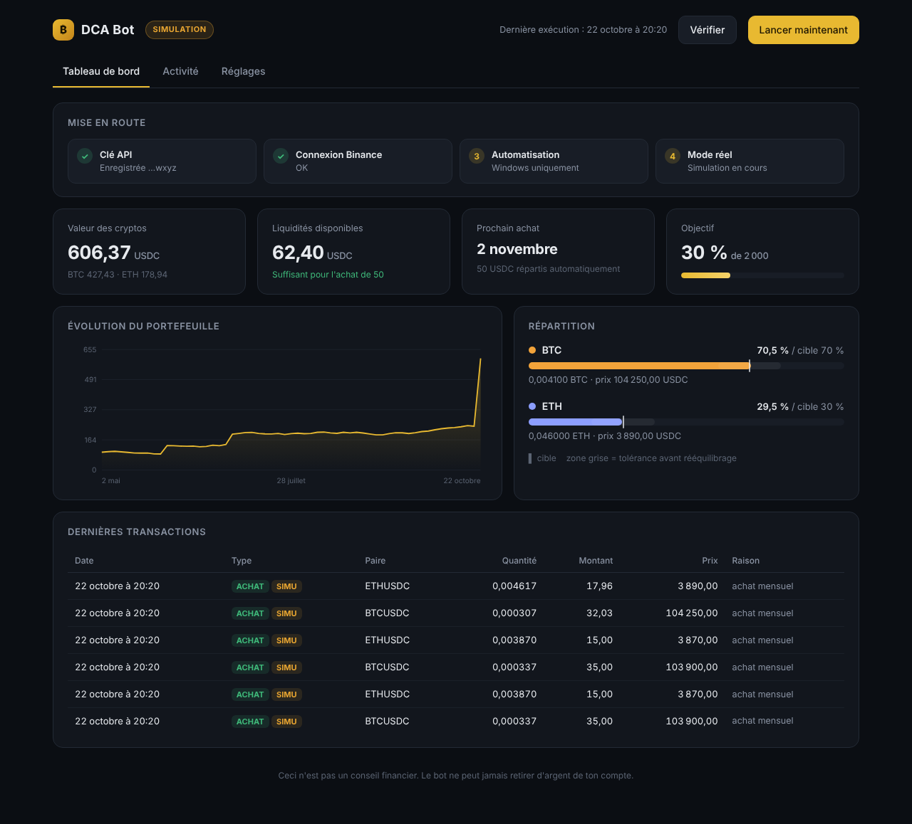

# Binance DCA Bot

Un bot qui investit automatiquement un montant fixe chaque mois en Bitcoin et Ethereum, garde la répartition choisie et se pilote depuis un tableau de bord local.



## Ce qu'il fait

- **Achat mensuel automatique** (stratégie DCA) : le budget va en priorité à la crypto en retard sur sa cible, ce qui rééquilibre sans rien vendre.
- **Rééquilibrage** quand une crypto s'écarte de plus de 10 points de sa cible, au maximum une fois tous les 30 jours.
- **Alerte d'objectif** quand le portefeuille atteint un montant choisi.
- **Tableau de bord** sombre : portefeuille, évolution, répartition, transactions, réglages, automatisation en un clic.
- **Notifications Telegram** optionnelles.

## Sécurité avant tout

- Le bot **refuse de démarrer si la clé API autorise les retraits** ou les transferts.
- Aucun code de retrait n'existe dans le projet.
- **Mode simulation** par défaut : les ordres passent par l'endpoint de test de Binance, validés mais jamais exécutés.
- Le tableau de bord n'écoute que sur `127.0.0.1`, vérifie l'en-tête `Host` et exige un jeton secret pour chaque action.
- Les montants sont calculés en `Decimal` pour éviter les erreurs d'arrondi des `float`.

## Choix techniques

| Choix | Pourquoi |
| --- | --- |
| Python, bibliothèque standard uniquement | Rien à installer, aucune dépendance tierce à surveiller |
| Signature HMAC-SHA256 écrite à la main | Nécessaire sans bibliothèque Binance, vérifiée sur l'exemple officiel |
| État dans un fichier JSON, écriture atomique | Pas d'achat en double, pas de fichier corrompu en cas de coupure |
| Tâche planifiée Windows quotidienne | Rattrape automatiquement un achat manqué si la machine était éteinte |
| Interface HTML/CSS/JS sans framework | Une seule page, servie par le serveur Python intégré |

## Structure

```
bot.py            Moteur : client Binance, logique d'achat et de rééquilibrage
app.py            Serveur local du tableau de bord (API JSON)
ui/index.html     Interface
tests.py          Tests hors-ligne avec un faux Binance
config.json       Réglages (répartition, budget, objectif...)
```

## Démarrer

Prérequis : Python 3.9 ou plus récent.

```bash
python app.py        # ouvre le tableau de bord sur http://127.0.0.1:8765
python tests.py      # lance les tests
```

Le guide complet (création de la clé API, alimentation du compte, automatisation) est dans [LISEZMOI.md](LISEZMOI.md).

## Tests

12 tests couvrent la répartition des achats, le rééquilibrage et son délai, le refus des clés dangereuses, l'absence de double achat dans le mois et le mode simulation.

---

*Projet personnel d'apprentissage. Ce n'est pas un conseil financier : les cryptomonnaies sont très volatiles.*
